# Entity Relationship Diagram & Domain Class Model (`ERD.md`)

> Derived from Bab III–IV (FR-01…FR-13, UC-04…UC-09), the BPMN To-Be diagram of 774 HUB, and Section 12 of the Master Prompt.  
> **`orders` is the single root transaction table** connecting Customer Ordering, POS, Payment, Kitchen Display System (KDS), Digital Invoice, Loyalty & Rewards, RFM Analysis, Behavioral Promotion Engine, and Sales/Revenue Reporting.

---

## 1. Mermaid Entity Relationship Diagram (`erDiagram`)

```mermaid
erDiagram
    USERS ||--o| MEMBERS : "has member profile (1:0..1)"
    USERS ||--o{ ORDERS : "created_by (POS Kasir)"
    USERS ||--o{ ORDER_STATUS_HISTORIES : "actor_user_id"
    USERS ||--o{ PAYMENTS : "confirmed_by (Tunai)"
    USERS ||--o{ PROMOTIONS : "created_by / updated_by"

    MEMBERS ||--o{ ORDERS : "places (1:N)"
    MEMBERS ||--o{ POINT_LEDGER : "earns/redeems (1:N)"
    MEMBERS ||--o{ REWARD_REDEMPTIONS : "redeems (1:N)"
    MEMBERS ||--o{ PROMOTION_USAGES : "uses (1:N)"
    MEMBERS ||--o{ PROMOTION_RETURNS : "tracked return (1:N)"
    MEMBERS ||--o{ RFM_RESULTS : "scored in (1:N)"

    CATEGORIES ||--o{ PRODUCTS : "contains (1:N)"
    PRODUCTS ||--o{ ORDER_ITEMS : "referenced in (1:N)"
    DINING_TABLES ||--o{ ORDERS : "seated at (1:N)"

    ORDERS ||--|{ ORDER_ITEMS : "contains (1:N)"
    ORDERS ||--|{ ORDER_STATUS_HISTORIES : "tracks transitions (1:N)"
    ORDERS ||--o{ PAYMENTS : "paid via attempts (1:N)"
    ORDERS ||--o| INVOICES : "generates (1:0..1)"
    ORDERS ||--o{ POINT_LEDGER : "awards/reverses points (1:0..N)"
    ORDERS ||--o| PROMOTION_USAGES : "applies promo (0..1:1)"
    ORDERS ||--o| REWARD_REDEMPTIONS : "uses voucher (0..1:1)"
    ORDERS ||--o{ PROMOTION_RETURNS : "returned_order_id"

    INVOICES ||--o{ INVOICE_DELIVERIES : "delivered via (1:N)"

    REWARDS ||--o{ REWARD_REDEMPTIONS : "redeemed as (1:N)"
    REWARD_REDEMPTIONS ||--o| POINT_LEDGER : "debits points"

    PROMOTIONS ||--o{ PROMOTION_USAGES : "recorded in (1:N)"
    PROMOTION_USAGES ||--o| PROMOTION_RETURNS : "tracks next visit (1:0..1)"

    RFM_ANALYSES ||--o{ RFM_RESULTS : "produces (1:N)"
    RFM_SEGMENTS ||--o{ RFM_RESULTS : "classifies (1:N)"

    USERS {
        bigint id PK
        string name
        string email UK
        string phone UK "nullable"
        string password
        boolean is_active
        boolean is_demo
        timestamp last_login_at
        timestamps created_at_updated_at
    }

    MEMBERS {
        bigint id PK
        bigint user_id FK,UK
        string member_code UK
        bigint points_balance "cached sum"
        timestamp consent_at "UU PDP No. 27/2022"
        timestamp joined_at
        timestamps created_at_updated_at
    }

    CATEGORIES {
        bigint id PK
        string name
        int sort_order
        boolean is_active
        boolean is_demo
        timestamp deleted_at
    }

    PRODUCTS {
        bigint id PK
        bigint category_id FK
        string slug UK
        string name
        string description
        bigint price "integer Rupiah"
        string image_path
        boolean is_available
        boolean is_active
        boolean is_demo
        timestamp deleted_at
    }

    DINING_TABLES {
        bigint id PK
        string number UK "e.g. 01..12"
        string label "e.g. Meja 07"
        string qr_token UK ">= 32 chars"
        boolean is_active
        boolean is_demo
    }

    ORDERS {
        bigint id PK
        string order_number UK "774-YYYYMMDD-####"
        string order_code "4-char handover code"
        string public_token UK "Guest tracking token"
        string client_request_id UK "Idempotency UUID"
        string source "qr | pos"
        bigint table_id FK
        bigint member_id FK "nullable (Guest if null)"
        string customer_name
        string customer_email
        string customer_phone "nullable"
        string status "Menunggu Pembayaran|Dibayar|Diproses|Siap|Selesai|Dibatalkan"
        string payment_method "tunai | qris | null"
        bigint subtotal "integer Rupiah"
        bigint discount_amount "integer Rupiah"
        decimal tax_rate "5,2"
        bigint tax_amount "integer Rupiah"
        bigint total_amount "integer Rupiah"
        bigint promotion_id FK "nullable"
        bigint reward_redemption_id FK "nullable"
        boolean is_repeat_order
        timestamp paid_at "nullable"
        timestamp completed_at "nullable"
        timestamp cancelled_at "nullable"
        string cancel_reason "nullable"
        bigint created_by FK "nullable (POS Kasir)"
        bigint handed_over_by FK "nullable (Pelayan function)"
        boolean is_demo
        timestamps created_at_updated_at
    }

    ORDER_ITEMS {
        bigint id PK
        bigint order_id FK
        bigint product_id FK
        string product_name "snapshot"
        bigint unit_price "snapshot Rupiah"
        int quantity
        string note "nullable <= 200 chars"
        bigint line_total "snapshot Rupiah"
    }

    ORDER_STATUS_HISTORIES {
        bigint id PK
        bigint order_id FK
        string from_status "nullable"
        string to_status
        bigint actor_user_id FK "nullable"
        string source "customer|pos|kds|system|webhook"
        string reason "nullable"
        timestamp created_at
    }

    PAYMENTS {
        bigint id PK
        bigint order_id FK
        string method "tunai | qris"
        string status "pending|paid|failed|expired|cancelled|amount_mismatch"
        bigint amount "integer Rupiah"
        string provider "cash | mock_qris | ..."
        string provider_reference "nullable, UK per provider"
        text qris_payload "nullable"
        timestamp expires_at "nullable"
        timestamp paid_at "nullable"
        bigint confirmed_by FK "nullable (Kasir)"
        bigint cash_received "nullable"
        bigint change_amount "nullable"
        string failure_reason "nullable"
        timestamps created_at_updated_at
    }

    PAYMENT_WEBHOOK_EVENTS {
        bigint id PK
        string provider
        string event_id "UK(provider, event_id)"
        json payload
        boolean signature_valid
        timestamp processed_at
        string result
    }

    INVOICES {
        bigint id PK
        bigint order_id FK,UK
        string invoice_number UK "INV-774-YYYYMMDD-####"
        timestamp issued_at
        string pdf_path "nullable"
        json snapshot
    }

    INVOICE_DELIVERIES {
        bigint id PK
        bigint invoice_id FK
        string channel "email | whatsapp"
        string recipient
        string status "pending | sent | failed"
        int attempt_no
        string provider_message_id "nullable"
        text error_message "nullable"
        timestamp sent_at "nullable"
        string triggered_by "system or user_id"
    }

    POINT_LEDGER {
        bigint id PK
        bigint member_id FK
        bigint order_id FK "nullable, UK(order_id, type)"
        bigint reward_redemption_id FK "nullable"
        string type "earn | redeem | reversal | adjust"
        bigint points "signed integer"
        bigint balance_after
        string note
        timestamp created_at
    }

    REWARDS {
        bigint id PK
        string name
        string description
        bigint points_cost
        string benefit_type "discount_nominal | discount_percent | free_product"
        bigint benefit_value
        int valid_days
        boolean is_active
        boolean is_demo
    }

    REWARD_REDEMPTIONS {
        bigint id PK
        bigint member_id FK
        bigint reward_id FK
        string voucher_code UK
        bigint points_spent
        string status "active | used | expired | cancelled"
        timestamp redeemed_at
        bigint used_order_id FK "nullable"
        timestamp expires_at
    }

    PROMOTIONS {
        bigint id PK
        string code UK
        string name
        string rule_type "comeback|repeat_order|hari_besar|welcome_next_visit|slow_hour|return_tracking"
        string description
        string benefit_type "percent | nominal | bonus_points"
        bigint benefit_value
        bigint max_discount "nullable"
        timestamp starts_at
        timestamp ends_at
        json target_segments "RFM segment slugs or all"
        bigint min_transaction "default 0"
        int usage_limit "nullable"
        int per_member_limit "default 1"
        json conditions "rule-specific parameters"
        boolean is_active
        boolean is_demo
        timestamp deleted_at
    }

    PROMOTION_USAGES {
        bigint id PK
        bigint promotion_id FK
        bigint order_id FK,UK
        bigint member_id FK
        bigint discount_amount
        timestamp used_at
    }

    PROMOTION_RETURNS {
        bigint id PK
        bigint promotion_usage_id FK,UK
        bigint member_id FK
        bigint returned_order_id FK "nullable"
        int days_to_return "nullable"
        bigint return_order_value "nullable"
        timestamp evaluated_at "nullable"
    }

    RFM_PARAMETERS {
        bigint id PK
        string key UK
        json value
        bigint updated_by FK "nullable"
    }

    RFM_SEGMENTS {
        bigint id PK
        string slug UK
        string name
        string description
        json rule "R/F/M score bounds"
        int priority "ordered evaluation"
        boolean is_active
    }

    RFM_ANALYSES {
        bigint id PK
        date analysis_date
        int period_days
        json parameters_snapshot
        string triggered_by
        boolean is_demo
        timestamp created_at
    }

    RFM_RESULTS {
        bigint id PK
        bigint rfm_analysis_id FK
        bigint member_id FK
        int recency_days "nullable"
        int frequency
        bigint monetary
        int r_score "1..5"
        int f_score "1..5"
        int m_score "1..5"
        bigint segment_id FK
    }

    SETTINGS {
        bigint id PK
        string key UK
        text value
        string type "string|int|float|bool|json"
        string description
        bigint updated_by FK "nullable"
    }
```

---

## 2. UML Domain Class Overview (`classDiagram`)

```mermaid
classDiagram
    class Order {
        +int id
        +string order_number
        +string order_code
        +string public_token
        +OrderStatus status
        +int subtotal
        +int discount_amount
        +float tax_rate
        +int tax_amount
        +int total_amount
        +scopeSuccessful()
        +isEditable() bool
        +canBeCancelledBy(User) bool
    }

    class OrderPricingService {
        +calculate(CartData, ?Member, ?Promotion, ?RewardRedemption) PricingBreakdown
    }

    class OrderStateMachine {
        +transition(Order, OrderStatus to, ?User actor, string source, ?string reason) Order
        +canTransition(Order, OrderStatus to, ?User actor) bool
    }

    class PaymentService {
        +initiateQris(Order) Payment
        +confirmCash(Order, User kasir, ?int cashReceived) Payment
        +handleWebhook(string provider, array payload, string signature) PaymentWebhookEvent
        +expireStaleQris() int
    }

    class InvoiceService {
        +generateForPaidOrder(Order) Invoice
        +dispatchDelivery(Invoice, string channel, string triggeredBy) InvoiceDelivery
        +resend(Invoice, User actor, ?string emailOverride) InvoiceDelivery
    }

    class LoyaltyService {
        +awardForOrder(Order) ?PointLedger
        +reverseForCancelledOrder(Order) ?PointLedger
        +redeemReward(Member, Reward) RewardRedemption
    }

    class RfmService {
        +runAnalysis(?Carbon analysisDate, ?int periodDays, string triggeredBy) RfmAnalysis
        +recomputeForMember(Member) ?RfmResult
        +scoreDimension(int value, array thresholds, bool lowerIsBetter) int
    }

    class PromotionEngine {
        +eligiblePromotions(Member, int subtotal, Carbon now) Collection
        +evaluateRule(Promotion, Member, int subtotal, Carbon now) bool
        +recordUsage(Order) ?PromotionUsage
        +evaluateReturnTracking(Order) void
    }

    Order <-- OrderPricingService : prices
    Order <-- OrderStateMachine : transitions
    Order <-- PaymentService : confirms payment
    Order <-- InvoiceService : issues invoice
    Order <-- LoyaltyService : awards points
    Order <-- PromotionEngine : evaluates & records
    RfmService --> PromotionEngine : provides segment
```

